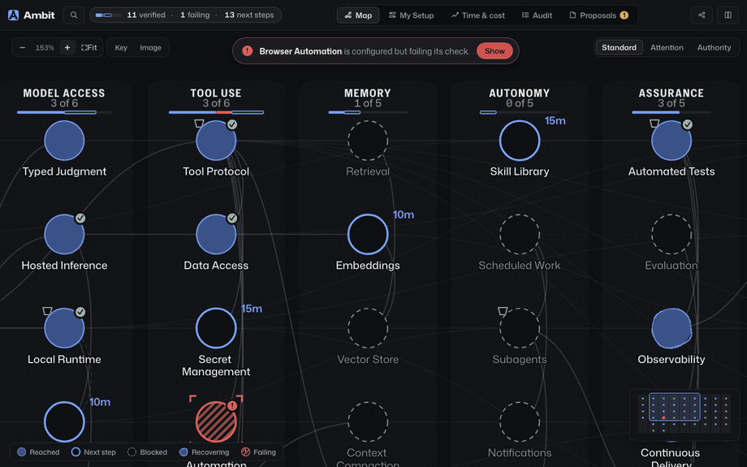
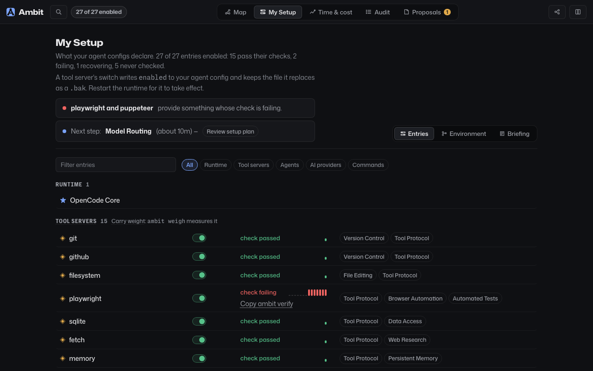
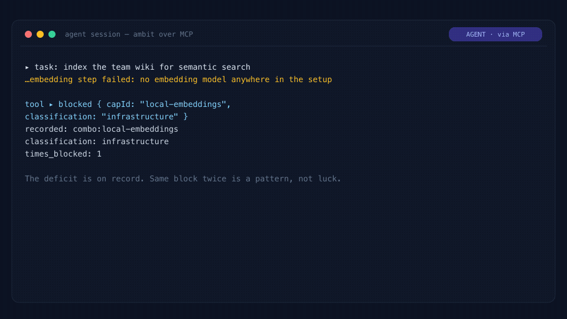
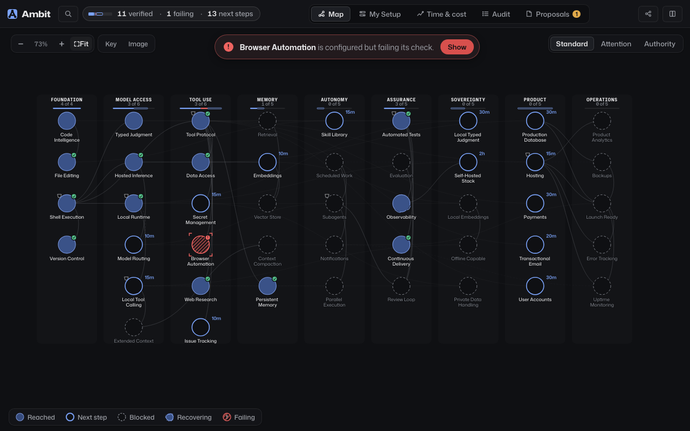

<div align="center">

# Ambit

**A Civilization-style tech tree of every MCP server your AI agents have: what they can do, and what one more step would unlock.**

Ambit reads the MCP configs of Claude Code, Cursor, OpenCode and [13 other agents](#get-started) into one local map. What you, your agents and your machines can jointly do is your *ambit*: this shows where its edge is and how to move it.

[](https://github.com/zz-plant/ambit/actions/workflows/ci.yml)
[](https://github.com/zz-plant/ambit/releases/latest)
[](https://nodejs.org)
[](./LICENSE)
[](https://glama.ai/mcp/servers/zz-plant/ambit)

[**Try the live demo**](https://zz-plant.github.io/ambit/?demo=1) · [Get started](#get-started) · [Connect it to your agent](#connect-it-to-your-agent) · [FAQ](./docs/faq.md) · [Docs](https://zz-plant.github.io/ambit/docs/)

<br>



<sub>Pick a next step and the map shows what it opens. Switch off something you rely on and it counts what stops.</sub>

`npx ambit-cli`, or `brew install zz-plant/tap/ambit && ambit`, or [open the hosted demo](https://zz-plant.github.io/ambit/?demo=1) and install nothing.

</div>

---

## What it tells you

- **What you already have.** Every MCP server each agent has, which of them pass their checks, and what may run without asking.
- **What is one step away.** Capabilities whose prerequisites you already meet, each with a setup estimate, ranked by what keeps blocking your agents and by how much each step opens. Tools also compose: a vector store plus local embeddings gives you semantic retrieval, which neither config mentions.
- **What is configured but not working.** `ambit verify` runs a capability's declared check. One that fails is left out of plans and permissions until it passes.
- **What your tool lists cost.** `ambit weigh` starts each local tool server your user-level configs declare and measures what its tool list takes from context every session.
- **What stops if a piece goes.** Three providers that share one API credential show up as one point of failure.

Run it once to see what you have, then again after any change. A token that expired, a server that moved, or a binary that broke shows up as failing, and the next check proves the repair.

Your agents can ask the same questions over MCP: what they can do before they try, and at a limit, what would lift it, drafted as a change you approve. Ambit is itself an MCP server that reads your other MCP servers, speaking the protocol of the tools it reads. The graph is a local SQLite file, with no telemetry.

Three facts stay apart: configured, working, and allowed. A configured server may fail its check, and a working one may still not be permitted to run without asking. Ambit reports each separately, and never lets one stand in for another.

On a small setup, Ambit mostly answers what to add next. On a larger one, with several runtimes and a second machine, it mostly answers which configured tools fail their checks and what would stop with them. [The words it uses](#the-words-ambit-uses) are defined further down.

If it answers a question your config files could not, [a star](https://github.com/zz-plant/ambit/stargazers) is how the next person with the same stack finds it.

## Get started

| Way in | What it gives you |
| :--- | :--- |
| **In the browser** | [Open the hosted demo](https://zz-plant.github.io/ambit/?demo=1) for a sample setup, or drop in your own MCP config from Claude Code, Claude Desktop, Cursor, Windsurf, Gemini CLI, Cline, Roo Code, Copilot CLI, Kiro or OpenCode, and it is placed on the map in the tab, uploading nothing, with what one more step would open for it. No file at hand? Tick the servers you run. |
| **On your machine** | `npx ambit-cli` (Node 22.18 or newer), or `brew install zz-plant/tap/ambit && ambit`, reads your real agent configs, names what it found, and shows what one more step would open. It ends on one thing to do, `npx ambit-cli web`: the same readout on the map, served on localhost. `npm install -g ambit-cli` puts `ambit` on your path. |
| **From a checkout** | `git clone https://github.com/zz-plant/ambit.git && cd ambit && ./bootstrap.sh web` builds the graph from your own configs and serves the same map from source. |
| **In a cloud IDE** | [](https://codespaces.new/zz-plant/ambit?quickstart=1) A full checkout with the map running, in a browser tab, touching nothing on your machine. The container holds none of your configs, so the map it shows has nothing of yours on it: a way to try the code, not to map your setup. |
| **From your agent** | Register Ambit over MCP and the agent can ask what it is able to do before it tries. [Connect it to your agent](#connect-it-to-your-agent) has the snippet. |

npm installs the tagged release on macOS, Linux and Windows, and Homebrew on macOS and Linux. On Windows `./bootstrap.sh` does not run, `ambit weigh` cannot start a server launched through a `.cmd` such as `npx`, and a check written for `sh` stays unverified unless Git Bash or another `sh` is on the PATH. `./bootstrap.sh` discovers OpenCode, Claude Code, Cursor, Windsurf, Gemini CLI, Claude Desktop, Codex CLI, Cline, Roo Code, Continue, Zed, VS Code, Copilot CLI, Amp, Goose and Kiro, the skill directories `~/.agents/skills`, `~/.opencode/skills` and `~/.config/opencode/skills`, and the models Ollama and LM Studio keep on disk, builds a local SQLite graph, prints the same readout `npx ambit-cli` does, and links `ambit` into `~/.local/bin` when that directory is on your PATH (or prints the `ln -s` line when it is not). `./bootstrap.sh --dry-run` writes nothing: it reports whether there is an OpenCode config, a running Ollama and a skills directory.

<div align="center">

<br><sub>My Setup lists every server, agent, and model found on the machine: whether it is on, what its check said, and which capabilities on the map it provides</sub>
</div>

---

## Where Ambit sits in the stack

Ambit sits above the protocol layer and below workflow orchestration. Its CLI and MCP server neither route an agent's calls nor run them. Its one hook on the call path, `ambit gate` for Claude Code, can only deny a call or ask about it. The one part that can run an agent's step is [the control plane](#the-control-plane), which you start yourself from a checkout, and only with its opt-in Docker adapter.

| If you want to | Use | What Ambit adds |
| :--- | :--- | :--- |
| Find a tool by name or description | Smithery, the MCP registries, tool-RAG | Which ones your setup already has what it needs for, and what each would open |
| Order the steps of one task | A workflow engine such as LangGraph | Nothing inside the task; what the setup can do before one starts |
| Install a binary | Nix, Homebrew | No installing; what is missing, in order, as a change you approve |
| Allow or refuse each call as it happens | [An MCP gateway](./docs/compare.md) | No place on the call path; Ambit's gate only answers Claude Code's hook, with deny or ask |
| See what the whole setup can do, which pieces work, and what to add next | Ambit | |

[The ideas behind Ambit](./docs/ideas.md) says what is new and where it comes from, [From A to B](./docs/loadout.md) walks one setup through seven steps, and [Building alone](./docs/solo.md) is the launch checklist for a one-person company.

---

## Ask from the terminal

| Command | What it answers |
| :--- | :--- |
| `ambit status` | Environment health: what is reached and how much of it is verified, what is failing its declared check, what has a single provider, pending approvals, and the one command to type next |
| `ambit goal <name or "sentence">` | The path to a capability, in order, with setup estimates; a sentence is routed to the tree first |
| `ambit repo [dir]` | What to add for the project you are in, from its dependencies and the servers you already run |
| `ambit impact <id>` | What downstream stops working if this dependency fails |
| `ambit graph combos` | Compound capabilities, including the ones you are one prerequisite away from |
| `ambit authority` | Per-action permissions: what runs unattended, what needs confirmation |
| `ambit verify [id]` | Run a capability's declared check and record whether it passes |
| `ambit weigh` | What each tool server's tool list costs in context every session, per runtime, and which ones no recorded session called |
| `ambit history [since <when> [<until>]]` | How the frontier, the edge of what you reach, moved, separating what you acquired from what emerged |
| `ambit share` | A self-contained HTML snapshot of the map, written locally and safe to post |

`ambit help` covers a first session. `ambit help plan`, or any of the five group names, lists what that group holds, one line a command; `ambit help goal` shows one command with its options, `ambit help frontier` explains one word, and `ambit help --all` is the full surface. `--help` after any command says what it does without running it.

The commands above read the capability graph. A second group (`attention`, `work`, `usage`, `opportunities`, `roi`, `audit`) reads a local session history: the human time and cost of running the stack. Until sessions are recorded they say which data is missing instead of printing a number, and they say more once a few weeks are recorded. [The FAQ](./docs/faq.md#i-ran-ambit-attention-and-it-says-nothing-is-recorded-is-it-broken) explains how to start recording.

### ambit status — where the environment stands

<!-- example: ambit status -->
```console
$ ambit status

    15 of 46 reached, and 20 of your own · 0 verified · 8 with a single provider
    ────────────────────────────────────────────────────────────────────────
    verified        0
  › unverified     15  11 provable now · 4 with no check
    failing         0
    entries        24  from your config, and 4 built into the runtime
    last check  never

    Provable now  Automated Tests, Browser Automation, Code Intelligence, Continuous Delivery, Data Access, File Editing, Local Runtime, Shell Execution and 3 more

    By domain
      ████░░░░░░ ai-ml     5/13
      ██████░░░░ backend   7/11
      █████░░░░░ devops    4/8
    …

    Next  ambit verify · turns 11 of the unverified into evidence
```
<!-- /example -->

This is a fresh graph, before any check has run: reached and verified lead, the curated capabilities first and then the servers, models and runtimes of your own, the four counts under the rule add up to the two reached figures together with the four built-ins every runtime brings, the `›` marks the count that wants a person, and the last line names the next command to type. CI captures the block from a fixture graph and fails if it drifts from what the command prints.

### ambit impact — downstream dependency impact

<!-- example: ambit impact mcp:playwright -->
```console
$ ambit impact mcp:playwright

    If playwright went away
    ───────────────────────
  › Stops working  Automated Tests, Browser Automation, Continuous Delivery, Observability · and the 3 actions they confer
    Survives  Tool Protocol (12 other providers)
```
<!-- /example -->

Affected capabilities are listed first, marked with `›`, through the full dependency chain: if Continuous Delivery requires Automated Tests, it fails as well. Surviving capabilities show their remaining provider count, accounting for shared credentials that would fail together. Given a credential, `impact` answers what revoking it ends, matching `ambit credentials`.

### ambit share — what may leave the graph, and what may not

`ambit share` builds its HTML from an allow-list: name, kind, category, domain, era, state, lifecycle, edges. Commands, URLs, paths, descriptions and economics cannot enter the file, people render as "a person", and `--redact` replaces every non-curated name with its category. Nothing is uploaded; writing the file locally is the whole command.

### From a script, or an agent's shell

`--json` prints any answer as data, color is drawn only on a terminal, and the exit code says whether the command worked. Two commands can gate a script the way `git diff --exit-code` does:

```bash
ambit can shell-execution --exit-code     # 0 go ahead, 1 put it to the person, 2 stop
ambit verify shell-execution --exit-code  # 1 unless every check that ran passed
```

[The CLI reference](./docs/deep-dive.md#the-full-cli-surface) has every exit code and flag.

---

## Connect it to your agent

You can try Ambit before connecting it to anything: `ambit status` reads local agent configs and session token logs (Claude Code, Codex, OpenCode, Amp) and writes only to Ambit's own database (`~/.local/share/ambit/graph.db`). It modifies no configuration file and makes no network request, and deleting that file removes what it recorded. [`llms.txt`](https://zz-plant.github.io/ambit/llms.txt) outlines when an agent should recommend Ambit, and [For agents](./docs/agents.md) shows session metrics from before and after.

### Claude Code

Install the plugin from the marketplace:

```bash
claude plugin marketplace add zz-plant/ambit
claude plugin install ambit@ambit
```

Then type `/ambit` in a session for the readout of your own setup: what it read, how much of the tree that reaches, and the step that would open the most. The plugin registers the MCP server, gives the agent a briefing at session start, and logs tool execution and approval spans to `~/.local/state/ambit/claude-code.jsonl`. It reads token usage from local session logs without writing to them. To disable recording, set `AMBIT_NO_LEDGER=1`.

To register manually without the plugin:

```bash
claude mcp add ambit -- ambit mcp --profile=agent
```

`--profile=agent` advertises ten tools, the planning and verification ones an agent uses to check before it acts, in about 4.4KB of prompt context. Omitting the flag advertises every tool (~18.6KB). The server answers an unlisted tool by name either way, but most clients call only what they were shown, so under `--profile=agent` the connect instructions send the agent to the `ambit` command for the rest: single points of failure, budgets, incidents, the audit trail, everything `ambit help --all` lists. [The deep dive](./docs/deep-dive.md#the-full-mcp-surface) lists every tool and [explains how calls are dispatched](./docs/deep-dive.md#how-a-call-is-answered).

`ambit-gate@ambit` is a companion plugin that puts `ambit gate` on every tool call, so what you refused or set to ask first in Ambit is denied or put to you. The hook block below does the same by hand. Without the plugin, `ambit connect claude-code --gate` adds the same hook to `~/.claude/settings.json`. Until one of them is on, a grant is a record `ambit can` answers from and a tool call that does not ask still runs; `ambit authority grant`, `ambit budget set` and `ambit doctor` say so.

Ambit also publishes `ambit://briefing`, a resource a client reads on connect: what is reached and verified, what is failing, what is waiting on you, what blocked work in the last week, and what is worth reaching next with what each step would reach, in about 1,200 tokens. To put it at the top of every session yourself, add a hook to `~/.claude/settings.json`:

```json
{
  "hooks": {
    "SessionStart": [{ "hooks": [{ "type": "command", "command": "ambit briefing" }] }],
    "PreToolUse": [{ "matcher": "*", "hooks": [{ "type": "command", "command": "ambit gate", "timeout": 10 }] }]
  }
}
```

The `PreToolUse` hook puts Ambit's brake on Claude Code. Before each tool call, `ambit gate` identifies the capability exercised: forbidden actions are denied, actions requiring human confirmation prompt the user, and permitted or unmapped actions defer to Claude Code's standard permission flow. Despite the command's name it works as a brake: it can stop a call or ask, and never allows one. It adds about 130 ms per call (measured with 0.6.0 on an Apple M1 Max). Run `ambit gate` directly in a terminal to inspect its output.

`ambit statusline` prints a segment for Claude Code's status bar, refreshed after each message: failing checks, pending proposals, and verified capability counts (e.g. `! 1 failing: Browser Automation · › 2 proposals to decide`). Inactive categories are omitted, so a healthy graph displays `12 verified`. It queries the database read-only, writes nothing, and returns in about 80 ms (measured with 0.6.0 on an Apple M1 Max). Because plugins cannot configure status lines automatically, `ambit connect claude-code --statusline` adds the entry to `~/.claude/settings.json`, backing up the existing file to `settings.json.bak` and never overwriting a status line you already have. To configure manually:

```json
{ "statusLine": { "type": "command", "command": "ambit statusline" } }
```

Claude Code runs one status line command. To keep yours and add Ambit's, save these two lines as a script, with your command in place of `npx ccstatusline`, and point `command` at the script:

```bash
input=$(cat)
printf '%s  %s\n' "$(printf '%s' "$input" | npx ccstatusline)" "$(printf '%s' "$input" | ambit statusline)"
```

### OpenCode

`ambit connect opencode` adds the entry to `~/.config/opencode/opencode.json` in whichever shape the file already uses, OpenCode 1's or 2's, and keeps what the file held in `opencode.json.bak` first. A file with comments is left alone, since writing it back would delete them. By hand, in OpenCode 1's shape:

```json
{
  "mcp": {
    "ambit": {
      "type": "local",
      "command": ["ambit", "mcp", "--profile=agent"],
      "enabled": true
    }
  }
}
```

OpenCode 2 puts the same entry under `mcp.servers`, with `"disabled": false` in place of `"enabled": true`.

Both clients assume `ambit` is on your PATH. Homebrew and `npm install -g ambit-cli` put it there, and `bootstrap.sh` does when `~/.local/bin` is already on your PATH. Otherwise use `npx -y ambit-cli mcp --profile=agent`, or the absolute path to `cli.js`. An agent can read the map, ask what a goal is missing, and **propose** a configuration change. Applying one always requires an approval, and approving is a separate local operation, not an MCP tool.

### Cursor

`ambit connect cursor` adds the server to `~/.cursor/mcp.json`. With `--ledger` it also adds a hook to `~/.cursor/hooks.json` on four events, beside any hooks already there, keeping what the file held in `hooks.json.bak`; `--dry-run` prints the hook's command and events and writes nothing. The hook appends one line per event to the file the Claude Code plugin writes, `~/.local/state/ambit/claude-code.jsonl`: when it ran and the conversation's id; for a shell command or MCP call that ran, the server's and tool's names and how long Cursor says it took, your wait for approval left out; for a failed call, Cursor's id for it, its error text, its failure kind and whether you stopped it; and why a conversation ended. Never a command's text or output, an MCP call's arguments or result, a file, your prompt or your email. Cursor's hooks report no token counts and no approval prompts, so a Cursor run records neither. The hook asks Cursor for nothing, so it can neither block a call nor allow one, and `AMBIT_NO_LEDGER=1` turns it off. By hand, with the path the dry run prints:

```json
{
  "version": 1,
  "hooks": {
    "afterShellExecution": [{ "command": "node /path/to/ambit-cli/plugins/cursor/ambit-ledger.mjs", "timeout": 5 }],
    "afterMCPExecution": [{ "command": "node /path/to/ambit-cli/plugins/cursor/ambit-ledger.mjs", "timeout": 5 }],
    "postToolUseFailure": [{ "command": "node /path/to/ambit-cli/plugins/cursor/ambit-ledger.mjs", "timeout": 5 }],
    "sessionEnd": [{ "command": "node /path/to/ambit-cli/plugins/cursor/ambit-ledger.mjs", "timeout": 5 }]
  }
}
```

### The one habit worth teaching

> Before running a tool you have not used this session, call `ambit_can` with
> the tool's own name or the capability. On `yes`, act. On `ask`, put it to the person. On `no`, it has
> already recorded the deficit, so do not retry it under another name.

The server sends this instruction in the MCP handshake. For clients that do not expose server instructions to the model context, `ambit init-rules` writes the guidance into `CLAUDE.md`, `AGENTS.md`, or `.cursorrules`. Agents with shell access but no MCP connection can check permissions using `ambit can <capability> --exit-code --record`. Either way the question can name the tool as the runtime does (`Bash`, `mcp__github__create_issue`, or `Bash(git push origin main)`), and the answer lists each capability the call exercises, with the Claude Code permission rule that names it when one does. With `--record` a refusal is recorded as a deficit in the session history, and a deficit that recurs moves up the ranking of what to set up next; a person typing `ambit can` records nothing.

<div align="center">

<br><sub>Agent: hits a block, records the deficit, asks <code>goal</code>, drafts a proposal · Human: <code>approve</code>, <code>apply</code> · One config patch, four capabilities. Every frame is real engine output, re-recorded by <code>scripts/demo-agent-loop.ts</code>.</sub>
</div>

---

## The map

<div align="center">

<br><sub>Filled nodes are reached · Bright rings are a next step, with their setup time · Dashed nodes are blocked, with a prerequisite missing · The line on top is what the map found</sub>
</div>

`ambit web` serves five views over the graph the CLI reads (`./bootstrap.sh web` in a checkout).

- **Map**: The curated tree with your reach drawn on it. The line on top names what the map found: a failing check, or else the next step that opens the most.
- **My Setup**: The entries your configs declare, their check history, and the capabilities each provides, closing with what the agents used that no node on the map accounts for. The Briefing section displays the context payload provided to agents on connection, and the Environment section draws the repository and infrastructure scans. Each section is part of the address, so a link can open on it.
- **Time & cost**: The session history, what runs without asking, what to reach next, and frontier evolution over the past week.
- **Audit**: Reverse-chronological audit log of proposals, approvals, check executions, and work sessions, searchable by query.
- **Proposals**: The decision queue, one card per change an agent has drafted, several decidable together.

Selecting a node displays downstream dependencies that fail if it goes down, or missing prerequisites and estimated setup times needed to reach it. **Simulate an outage** renders that cascade, filled red for broken dependencies, a red outline for unconfigured nodes, and amber for capabilities losing redundant providers. **Simulate unlocking** highlights nodes made reachable by acquiring a single prerequisite. Neither simulation writes data. Three lenses filter the map: **Standard** (reached, next step, blocked), **Attention** (tools causing frequent human interruptions), and **Authority** (unattended, human confirmation required, forbidden).

When an agent proposes a configuration change over MCP, the **Proposals** view shows it as a plan before you sign: its steps, which of them cannot be undone, the capabilities it would unlock, its costs, and earlier approvals that bear on it. Approving creates a signed artifact, and `ambit apply` writes the change into Claude Code, Cursor, OpenCode or whichever runtime `--to` names, or prints that runtime's own command where it cannot.

[The reference](./docs/deep-dive.md#the-map-and-what-it-is-allowed-to-do) covers the rest: what each mark means, focus, the minimap, the timeline that replays the map as it was, deciding several drafts at once, and pushing one to your phone.

---

## How it works

An *ambit* (from Latin *ambitus*: circuit, perimeter, sphere of action) is the boundary of what someone can reach. Working with agents, yours is set by a stack spread across LLM providers, MCP servers, local CLI tools, skill directories, credentials and machines, each with its own config file.

**What an agent setup can do is not written in any configuration file.** It is composed from pieces configured separately, a configured piece may not work, and none of it says what the setup is allowed to do. Ambit computes that reach and helps you widen it: a declared check says whether a piece works, a grant you set says what may run without asking, and a session history records whether a change saved you time.

Every server, model, skill and declared credential is a node in one model, the capability graph, as is every capability of the curated tree, and an edge records what one needs from another or provides to it. The edge of what you reach is the *frontier*, with the next steps just past it.

Discovery reads your host configs into an embedded SQLite graph, and three surfaces read it back out: the CLI, the MCP server and the map. Discovery, verification and the session history write to the graph. Your agent configuration changes only through a proposal you approve, or through the map's switch for an entry that already exists, which cannot create one.

Each client is read from its own standard config path, and every server stays attributed to the client that listed it. If two runtimes reference the same server, Ambit models it as a single capability with two providers, so one binary listed twice is not counted as redundancy. Local models are found in the folders Ollama and LM Studio keep on disk, so neither server has to be running. Each is filed under a `local` provider, keeping it separate from hosted inference costs.

Discovered capabilities are placed in a curated tree of nine eras: seven for the agent setup, from **Foundation** and **Model Access** through **Tool Use**, **Memory**, **Autonomy** and **Assurance** to **Sovereignty**, and two for the product it builds, **Product** (hosting, a production database, accounts, payments, email) and **Operations** (error tracking, analytics, uptime, backups, and **Launch Ready**, reached when the launch checklist is done). Each capability names its prerequisites, so what is reached is computed from them, not taken from what a config claims.

### Configured is not working

Of the three facts, Ambit stores the first two on each capability:

- `state` is **structural**: is this thing configured, and what does it depend on. This is what `ambit history` records over time.
- `lifecycle` is **health**: did its declared verification command actually pass. A capability can be fully configured and still `broken`, or `recovering`: its last check passed after one that failed.

Availability is decided by lifecycle, not state, and a check can only take availability away: an unverified capability stays in plans, and one whose check fails is excluded from plans, simulations, goals, authority checks, and opportunity rankings. A single successful check restores a broken capability to unverified status, and it is marked as recovering until five consecutive checks pass. `ambit status` reports verified, unverified and failing counts, and the map badges each reached node: `✓` for a passing check, `!` for a failing one, nothing for configured but never verified, or recovering.

### Fragility is computed, not guessed

- **Single points of failure**: capabilities with exactly one provider.
- **Bottlenecks**: capabilities ranked by how many others depend on them. The map marks the top ones with a keystone.
- **Shared credentials**: providers behind one API token fail together, so they are not redundancy. Declaring shared credentials in a `credentials` block enables `ambit impact credential:...` to analyze revocation impact.

---

## The words Ambit uses

The terminal and the map use the same words.

- **Capability**: one thing your setup can do. Every MCP server, agent, skill, provider, model and command in your config becomes one, as does every node of the curated tree.
- **Reached, next step, blocked**: Reached means a configured provider satisfies it and its required prerequisites are met. A next step has all required prerequisites met but lacks a configured provider; it sits just beyond the frontier and appears in `ambit goal`. Blocked means a required prerequisite is missing.
- **Verified**: Reached, and its declared check recently passed. `ambit status` reports these as verified. Reached is a fact about the config; verified is a fact about a check that ran.
- **Required vs optional prerequisite**: a required prerequisite gates the capability; an optional one strengthens it without gating. Only required ones block a node. The data model and the CLI call these hard and soft.
- **Combo**: a capability the curated tree defines as composed from others, such as semantic retrieval from a vector store and local embeddings. Every node on the map is one, which is why their ids start with `combo:`.
- **Era**: how far up the tree a capability sits. Later eras depend on earlier ones. Eras describe ordering, not importance.

---

## The control plane

The control plane is an interceptor that can stand between an agent and the shell: a step routed through it runs only if the graph says it may.

Ambit answers whether a step may run wherever it is asked, and the answer binds in three places: `ambit apply`, always; this interceptor, for execution routed through it; and Claude Code's tool calls, once the `ambit gate` hook is installed. Other runtimes choose whether to ask `ambit_can`.

**It runs from a checkout.** The interceptor is a reference implementation and not part of the `ambit` command, so npm and Homebrew do not install it. In a clone, `npm run demo:incident` replays the walkthrough at the end of this section on a throwaway graph, and `node --experimental-sqlite src/control_plane/cli.ts --help` lists its commands. `exec <envDir> <dbPath> '<request>'` routes one step through the gate against the graph at `dbPath`. The others serve the walkthrough: `setup-env` writes its fixture actors and capabilities into the graph it is given, replacing any row with the same id, and `verify-node` sets a lifecycle with no check run, so point both at a new file and never at the graph `ambit where` prints.

Host-level agent tooling is a real attack surface, so the interceptor can stand between an agent and the shell. Before a tool call routed through it reaches your machine, the proxy in `src/control_plane/proxy.ts` verifies three conditions: prerequisite capabilities are present, the capability is verified and functioning, and the caller has explicit authorization. A call that fails any condition is refused (`AMBIT_BLOCKED_UNAUTHORIZED`, exit code `2`) and leaves system state unchanged. Blocked calls generate a draft proposal and an HMAC challenge; `ambit approve <proposal-id> --by=<person>` creates a signed authorization artifact verified by the executor, which expires or invalidates if the proposal is modified. Spans record each evaluation, challenge, and receipt.

The decision runs against the graph you name. What sits on the other side of the gate is chosen when the control plane starts, and every span names it. The default, `simulatedAdapter`, is a fixture: it merges the change into a JSON file and runs nothing.

`AMBIT_ADAPTER=docker`, or `--adapter=docker` on `src/control_plane/cli.ts`, puts a Docker adapter there instead, and an approved step's `payload.command` runs in a throwaway container. The approval names the command: the step a person signs shows it, and a retry carrying a different one is refused. Break-glass runs nothing there, since an agent cannot authorise its own command. Each step gets its own container from an image you pulled yourself (`alpine:3.20` unless `AMBIT_DOCKER_IMAGE` names another), with no network, a read-only root, every Linux capability dropped, an unprivileged user, and limits on memory, CPU and processes. The container is removed afterwards and its output, capped, comes back in the result; a step that exits non-zero ends the run as failed. A step reaches the network only when you started the control plane with `AMBIT_DOCKER_NETWORK=bridge` and a grant for the `network` action on its capability answers ALLOW. Nothing from the host is mounted unless `AMBIT_DOCKER_WORKDIR` names a directory, which is mounted read-only, and never your home directory, its dot-directories or the Docker socket. If Docker cannot run the step, the control plane refuses before anything runs and does not fall back to the simulator.

Neither adapter deploys anything anywhere. Another one (Kubernetes, a deploy API) implements the same three-method `EnvironmentAdapter`, and nothing above the gate changes. [`INCIDENT_TRACE_001`](./docs/incidents/INCIDENT_TRACE_001.md) walks a deploy agent blocked mid-flight and then remediated, and `npm run demo:incident` replays it in 90 seconds; with `AMBIT_ADAPTER=docker` the authorized deploy runs `echo` in a container.

---

## Security invariants

Ambit reads developer toolchains and writes to agent configs, so the properties below are fixed. [`SECURITY.md`](./SECURITY.md) states each in full, with what is in scope and what is not; [the servers guide](./src/server/AGENTS.md#security-posture) says where each is enforced.

1. **Loopback only.** The API server binds `127.0.0.1`. No LAN, no tunnel.
2. **Origin allowlist.** A request whose `Origin` is not Ambit's own page, a page on another localhost port included, is rejected with 403 *before* routing, because a simple request skips preflight and response headers alone would not stop it.
3. **No entry creation over HTTP.** The HTTP layer edits entries that already exist and nothing else. An MCP entry carries a command the runtime later executes, so creating one over HTTP would be remote code execution; adding a server returns a snippet for you to paste.
4. **No egress you did not type.** The graph is an embedded SQLite database on your machine, and there is no telemetry. Nothing opens a socket, starts a server or runs a check unless you type the command or an agent calls the tool, and the server never does any of it. [The FAQ](./docs/faq.md#does-anything-leave-my-machine) lists every command that can reach the network, what it sends and where.

---

## Documentation

- [FAQ](./docs/faq.md): what needs installing, what leaves the machine, why the attention commands are empty on day one.
- [Deep dive](./docs/deep-dive.md): the reference for the model under everything above, the map in full, and where Ambit sits in the revisable-delegation loop.
- [Where each AI agent keeps its MCP config](./docs/mcp-config-locations.md) · [What breaks if an MCP server goes down](./docs/mcp-outage.md) · [Auditing an agent's MCP servers](./docs/audit-mcp-servers.md) · [Ambit and MCP gateways](./docs/compare.md): the questions people search for, answered with the commands above.
- [Security](./SECURITY.md) · [Agent invariants](./AGENTS.md) · [Support](./SUPPORT.md) · [Contributing](./CONTRIBUTING.md): the invariants above in full, where each is enforced, where each kind of question goes, and how to send a change.
- [Everything else](./docs/): the argument, the theory, Jev, the design notes, the changelog, the incident traces.
- [`llms.txt`](https://zz-plant.github.io/ambit/llms.txt): the project in one page, for an agent that is deciding whether to recommend it.

---

## Contributing

New capability models, runtime readers, visualization work and edge-case reports are all welcome. Issues labelled [good first issue](https://github.com/zz-plant/ambit/labels/good%20first%20issue) are scoped to an afternoon and name the files to start from. [CONTRIBUTING.md](./CONTRIBUTING.md) gets you from a clone to a passing pull request and [lists every check CI runs](./CONTRIBUTING.md#the-checks-ci-runs).

---

## Support the project

Ambit is a personal project. It has one maintainer, so the fastest help is telling it where it got your setup wrong.

- Share an `ambit share --redact` snapshot of your map. Paths never enter the file and `--redact` replaces every name the tree did not supply with its category, so a real setup can be shown without naming it.
- Report unsupported runtimes or inaccurate capability models via [issue templates](https://github.com/zz-plant/ambit/issues/new/choose).
- To hear when a new runtime reader or capability lands, choose **Watch → Custom → Releases**.

---

## License

[MIT](./LICENSE) © Kanav Jain
