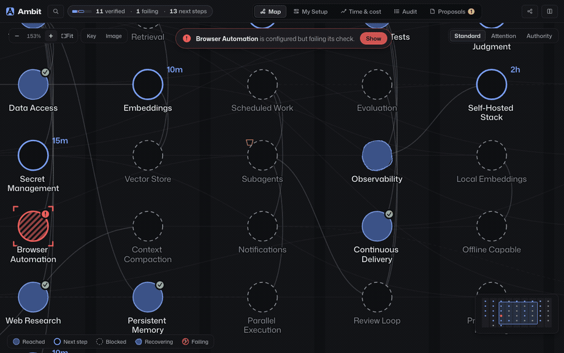
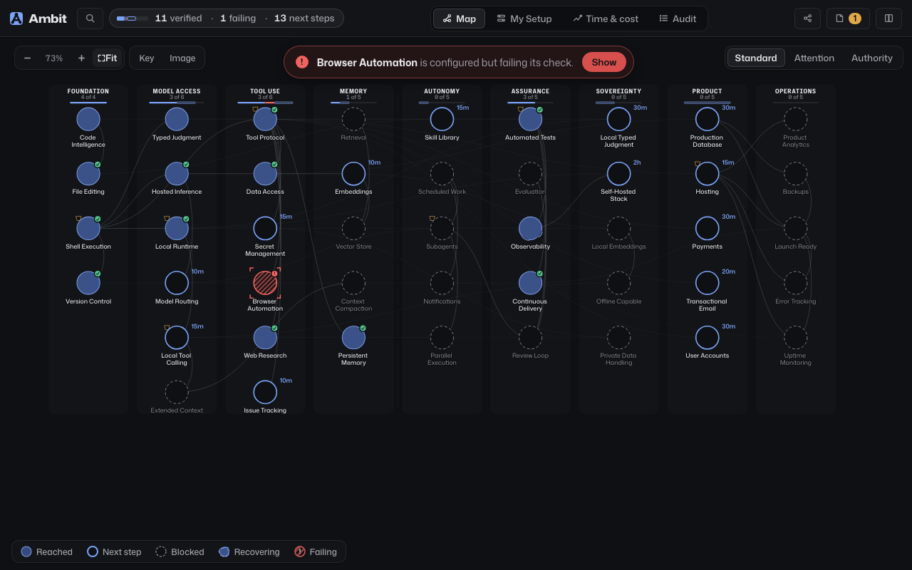
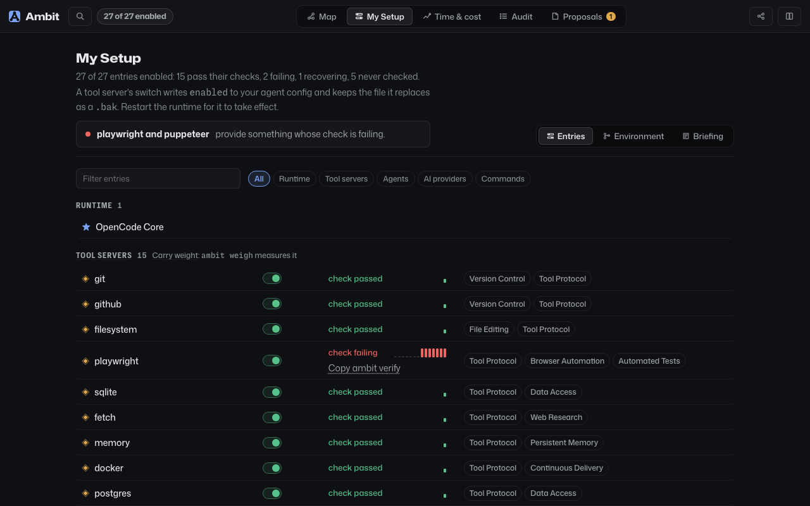
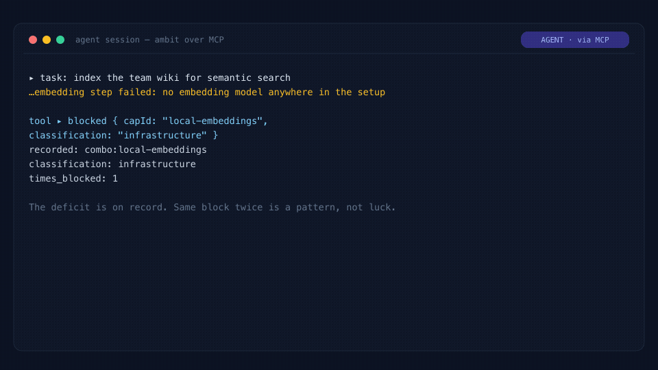

<div align="center">

# Ambit

**What you, your agents, and your machines can jointly do — and where your own time is going.**

That is your *ambit*. Ambit reads the configs of Claude Code, Cursor, OpenCode and [the other agent runtimes it knows](#get-started) into a local capability map: what you can do now, what one more step would unlock, and which configured tools are not working.

[](https://github.com/zz-plant/ambit/actions/workflows/ci.yml)
[](https://github.com/zz-plant/ambit/releases/latest)
[](https://nodejs.org)
[](./LICENSE)
[](https://glama.ai/mcp/servers/zz-plant/ambit)

[**Try the live demo**](https://zz-plant.github.io/ambit/?demo=1) · [Get started](#get-started) · [Connect it to your agent](#connect-it-to-your-agent) · [FAQ](./docs/faq.md) · [Docs](https://zz-plant.github.io/ambit/docs/)

<br>



<sub>One setup, mapped. Pick a next step and Ambit shows what it would open: four more capabilities. Pick one you rely on and switch it off, and it counts the nine working things that would stop with it. Then which tools interrupt you most, and a change waiting on your approval.</sub>

`npx ambit-cli`, or `brew install zz-plant/tap/ambit && ambit`, or [open the hosted demo](https://zz-plant.github.io/ambit/?demo=1) and install nothing.

</div>

---

## What Ambit is

An *ambit* (from Latin *ambitus*: circuit, perimeter, sphere of action) is the boundary of what someone can reach. Working with agents, yours is set by a stack spread across LLM providers, MCP servers, local CLI tools, skill directories, credentials and machines, each with its own config file. No single file records their combined capabilities, where the operational boundary lies, or how to expand it.

The core premise is that **what an agent setup can do is not written in any configuration file.** It is composed from pieces configured separately, a configured piece may not work, and none of it says what the setup is allowed to do. Ambit computes that reach and helps you widen it safely: declared checks verify what works, authority contracts gate permissions, and the attention ledger tracks whether changes save human time.

Ambit reads those configs into one model, the capability graph. Every server, model, skill and declared credential is a node, as is every capability of the curated tree, and an edge records what one needs from another or provides to it. My Setup lists what your configs declare, and the map draws the curated tree with your position on it. The edge of what you reach is the *frontier*, with the next steps just past it. The graph answers four questions no single file can:

1. **What is one step away?** Capabilities whose prerequisites you already meet, each with its estimated setup time, and near-miss combinations that are one or two prerequisites away from unlocking additional tools. Separately configured tools also compose: a vector store plus local embeddings satisfies the prerequisites for semantic retrieval, which neither configuration file mentions alone.
2. **What is worth setting up next?** Ranked by what keeps blocking your agents and by how much each step unlocks, and once the work ledger records a few weeks, by the human attention it would save.
3. **What actually works?** A configured tool is not necessarily a working one. Ambit runs each capability's declared verification check (`ambit verify`) and enforces `installed ≠ working ≠ authorized`. Unverified capabilities remain available, but any capability that fails a check is immediately excluded from plans and permissions until it passes again.
4. **What breaks if a dependency fails?** Ambit traces transitive dependencies: three supposedly redundant providers that share an API credential correctly show up as a single point of failure.

You ask from the terminal. Your agents ask over MCP: what they can do before they try, and when they hit a limit, what would lift it, drafted as a change you approve. Ambit is itself an MCP server, communicating using the same protocol as the tools it coordinates. The term for that is a *meta-MCP server*.

### The words Ambit uses

These carry most of the meaning, in the terminal and on the map alike.

- **Capability**: one thing your setup can do. Every MCP server, agent, skill, provider, model and command in your config becomes one, as does every node of the curated tree.
- **Reached, next step, blocked**: Reached means a configured provider satisfies it and its required prerequisites are met. A next step has all required prerequisites met but lacks a configured provider; it sits just beyond the frontier and appears in `ambit goal`. Blocked means a required prerequisite is missing.
- **Verified**: Reached, and its declared check recently passed. `ambit status` reports these as proven. Reached indicates structural availability, while verified confirms operational readiness through test evidence; a failing check excludes a capability from all plans until it passes again.
- **Required vs optional prerequisite**: a required prerequisite gates the capability; an optional one strengthens it without gating. Only required ones block a node. The data model and the CLI call these hard and soft.
- **Combo**: a capability the curated tree defines as composed from others, such as semantic retrieval from a vector store and local embeddings. Every node on the map is one, which is why their ids start with `combo:`.
- **Era**: how far up the tree a capability sits. Later eras depend on earlier ones. Eras describe ordering, not importance.

<div align="center">

<br><sub>Filled nodes are reached · Bright rings are a next step, with their setup time · Dashed nodes are blocked, with a prerequisite missing · The line on top is what the map found</sub>
</div>

---

## Who it is for

Anyone running AI agents who wants them to do more. A small setup with one runtime and a few MCP servers can quickly identify high-leverage next steps and capabilities unlocked by a single missing prerequisite. A larger setup with multiple runtimes, dozens of servers, and secondary machines benefits from health and dependency analysis: identifying broken configurations and cascading failure risks.

The demo walks a sample setup in five steps: the next step worth taking and what it would open, the outage that shows what that reach rests on, a check that was already failing, the approval every change waits for, and then your own config, pasted into the tab or picked from a list of common servers, placed on the same map with nothing uploaded, and the three next steps that would open the most for it.

## Get started

| Way in | What it gives you |
| :--- | :--- |
| **In the browser** | [Open the hosted demo](https://zz-plant.github.io/ambit/?demo=1) for a sample setup, or drop in your own MCP config from Claude Code, Claude Desktop, Cursor, Windsurf, Gemini CLI, Cline, Roo Code, Copilot CLI, Kiro or OpenCode, and it is placed on the map in the tab, uploading nothing, with what one more step would open for it. No file at hand? Tick the servers you run. |
| **On your machine** | `npx ambit-cli` (Node 22.18 or newer), or `brew install zz-plant/tap/ambit && ambit`, reads your real agent configs, names what it found, and shows what one more step would open. That is the CLI, the MCP server and the map: `ambit web` serves the map on localhost from any install. `npm install -g ambit-cli` puts `ambit` on your path. |
| **With the map** | `git clone https://github.com/zz-plant/ambit.git && cd ambit && ./bootstrap.sh web` builds the graph from your own configs and serves the map the pictures on this page show. |
| **In a cloud IDE** | [](https://codespaces.new/zz-plant/ambit?quickstart=1) A full checkout with the map running, in a browser tab, touching nothing on your machine. |
| **From your agent** | Register Ambit over MCP and the agent can ask what it is able to do before it tries. [Connect it to your agent](#connect-it-to-your-agent) has the snippet. |

npm and Homebrew install the tagged release, on macOS or Linux. `./bootstrap.sh` discovers OpenCode, Claude Code, Cursor, Windsurf, Gemini CLI, Claude Desktop, Codex CLI, Cline, Roo Code, Continue, Zed, VS Code, Copilot CLI, Amp, Goose and Kiro, the skill directories `~/.agents/skills`, `~/.opencode/skills` and `~/.config/opencode/skills`, and the models Ollama and LM Studio keep on disk, builds a local SQLite graph, links `ambit` into `~/.local/bin` (or prints the `ln -s` line when that is not on your PATH), and ends on `ambit status`. `--dry-run` shows what it would do first.

<div align="center">

<br><sub>My Setup lists every server, agent, and model found on the machine: whether it is on, what its check said, and which capabilities on the map it provides</sub>
</div>

---

## Where Ambit sits in the stack

Ambit sits above the protocol layer and below workflow orchestration. It neither routes calls nor runs them; it computes what the setup can do, verifies what actually works, and gates authority.

| System | Finds a tool | Knows prerequisite order | Tells working from configured | Prices human attention | Gates what an agent may do |
| :--- | :---: | :---: | :---: | :---: | :---: |
| Vector tool-RAG | by similarity | – | – | – | – |
| Workflow state machines (LangGraph) | – | within one task | – | – | within one task |
| Package managers (Nix, Homebrew) | – | for binaries | – | – | – |
| Flat MCP catalogs (Smithery, registries) | by name | – | – | – | – |
| **Ambit** | by what it needs | across the whole host | ✓ declared checks | ✓ work ledger | ✓ authority contracts, signed approvals |

For the architectural foundation, economic loop, and comparison to prior work, see [The ideas behind Ambit](./docs/ideas.md), [Your loadout, from A to B](./docs/loadout.md), and [Building alone](./docs/solo.md).

---

---

## Ask from the terminal

| Command | What it answers |
| :--- | :--- |
| `ambit status` | Environment health: what is reached and how much of it is proven, what is failing its declared check, what has a single provider, pending approvals, and the one command to type next |
| `ambit goal <name>` | The path to unlock a capability, in order, with setup estimates |
| `ambit impact <id>` | Impact analysis: downstream tools that break if this dependency fails |
| `ambit graph combos` | Compound capabilities, including the ones you are one prerequisite away from |
| `ambit authority` | Per-action permissions: what runs unattended, what needs confirmation |
| `ambit verify [id]` | Run a capability's declared check and record whether it passes |
| `ambit weigh` | What each tool server's tool list costs in context every session, per runtime, and which ones the ledger never saw called |
| `ambit history [since <when> [<until>]]` | How the frontier moved, separating what you acquired from what emerged |
| `ambit share` | A self-contained HTML snapshot of the map, written locally and safe to post |

`ambit help` covers a first session, `ambit help --all` the full surface, and `ambit help <term>` one concept.

The commands above query the capability graph built from your local configuration. A second group (`attention`, `work`, `usage`, `opportunities`, `roi`, `audit`) quantifies the human time and operational cost of running the stack using a local work ledger. Those commands indicate required data prerequisites instead of arbitrary numbers, gaining fidelity after recording a few weeks of agent sessions. [The FAQ](./docs/faq.md#i-ran-ambit-attention-and-it-says-nothing-is-recorded-is-it-broken) explains how to start recording.

### ambit status — where the environment stands

<!-- example: ambit status -->
```console
$ ambit status

    39 of 70 reached · 0 proven · 8 with a single provider
    ──────────────────────────────────────────────────────
    proven          0
  › unproven       15  11 provable now · 4 with no check
    failing         0
    entries        24  from your config; checks run on what they provide
    last check  never

    actions: 18/66 reached
    provable now: Automated Tests, Browser Automation, Code Intelligence, Continuous Delivery, Data Access, File Editing, Local Runtime, Shell Execution and 3 more
    domains:
      ████░░░░░░ ai-ml     5/13
      ██████░░░░ backend   7/11
      █████░░░░░ devops    4/8
    …

    Next  ambit verify · turns 11 of the unproven into evidence
```
<!-- /example -->

This is a fresh graph, before any check has run: reached and proven lead, the four counts under the rule add up to the reached figure, the `›` marks the count requiring human action, and the last line suggests the next command to type. CI captures the block from a fixture graph and fails if it drifts from what the command prints.

### ambit impact — downstream dependency impact

<!-- example: ambit impact mcp:playwright -->
```console
$ ambit impact mcp:playwright

    If playwright went away
    ───────────────────────
  › Stops working  Automated Tests, Browser Automation, Continuous Delivery, Observability · and the 3 actions they confer
    Survives  Tool Protocol (12 other providers)
```
<!-- /example -->

Affected capabilities are listed first, marked with `›`, through the full dependency chain: if Continuous Delivery requires Automated Tests, it fails as well. Surviving capabilities show their remaining provider count, accounting for shared credentials that would fail together. Given a credential, `impact` answers what revoking it ends, matching `ambit credentials`.

### ambit share — what may leave the graph, and what may not

`ambit share` builds its HTML from an allow-list: name, kind, category, domain, era, state, lifecycle, edges. Commands, URLs, paths, descriptions and economics cannot enter the file, people render as "a person", and `--redact` replaces every non-curated name with its category. Nothing is uploaded; writing the file locally is the whole command.

### From a script, or an agent's shell

`--json` prints any answer as data, color is drawn only on a terminal, and the exit code says whether the command worked. Two commands can gate a script the way `git diff --exit-code` does:

```bash
ambit can shell-execution --exit-code     # 0 go ahead, 1 put it to the person, 2 stop
ambit verify shell-execution --exit-code  # 1 unless every check that ran passed
```

[The CLI reference](./docs/deep-dive.md#the-full-cli-surface) has every exit code and flag.

---

## Connect it to your agent

Registered as an MCP server, Ambit lets an agent check what it can do before it tries, and plan around what is missing.

Ambit can be evaluated without modifying existing agent configurations: `ambit status` reads local agent configs and session token logs (Claude Code, Codex, OpenCode, Amp), writing strictly to Ambit's local database (`~/.local/share/ambit/graph.db`). It modifies no configuration files and makes no network requests. Deleting that file completely removes Ambit. A single status run revealing failing checks or single points of failure demonstrates immediate utility. [`llms.txt`](https://zz-plant.github.io/ambit/llms.txt) outlines when an agent should recommend Ambit, and [For agents](./docs/agents.md) demonstrates before-and-after session metrics.

### Claude Code

Install the plugin from the marketplace:

```bash
claude plugin marketplace add zz-plant/ambit
claude plugin install ambit@ambit
```

The plugin registers the MCP server, provides briefing at session start, and logs tool execution and approval spans to `~/.local/state/ambit/claude-code.jsonl`. Token usage is read read-only from local session logs. To disable recording, set `AMBIT_NO_LEDGER=1`.

To register manually without the plugin:

```bash
claude mcp add ambit -- ambit mcp --profile=agent
```

`ambit-gate@ambit` is a companion plugin that places `ambit gate` on every tool call to enforce authority contracts. Or configure hooks directly in `~/.claude/settings.json`:

`--profile=agent` exposes the ten core planning and verification tools an agent uses to check capabilities before acting, consuming approximately 4.4KB of prompt context. Omitting the flag advertises all sixty tools (~19.5KB), though unlisted tools remain callable by name in either mode. [The deep dive](./docs/deep-dive.md#the-full-mcp-surface) lists every tool and [explains how calls are dispatched](./docs/deep-dive.md#how-a-call-is-answered).

Ambit also publishes `ambit://briefing`, a resource a client reads on connect: what is reached and proven, what is failing, what is waiting on you, what blocked work in the last week, and what is worth reaching next with what each step would reach, in about 1,200 tokens. To put it at the top of every session yourself, add a hook to `~/.claude/settings.json`:

```json
{
  "hooks": {
    "SessionStart": [{ "hooks": [{ "type": "command", "command": "ambit briefing" }] }],
    "PreToolUse": [{ "matcher": "*", "hooks": [{ "type": "command", "command": "ambit gate", "timeout": 10 }] }]
  }
}
```

The `PreToolUse` hook binds Ambit's gate to Claude Code. Before each tool call, `ambit gate` identifies the capability exercised: forbidden actions are denied, actions requiring human confirmation prompt the user, and permitted or unmapped actions defer to Claude Code's standard permission flow. The gate can only restrict permissions, never expand them, adding ~125ms of latency per call. Run `ambit gate` directly in a terminal to inspect its output.

`ambit statusline` formats an informational segment for Claude Code's status bar, refreshed after each message: failing checks, pending proposals, and verified capability counts (e.g. `! 1 failing: Browser Automation · › 2 proposals to decide`). Inactive categories are omitted, so a healthy graph displays `12 verified`. It queries the database read-only, writes nothing, and returns in ~50ms on an installed binary. Because plugins cannot configure status lines automatically, `ambit connect claude-code --statusline` safely adds the entry to `~/.claude/settings.json` (backing up the existing file to `settings.json.bak` and never overwriting custom status lines). To configure manually:

```json
{ "statusLine": { "type": "command", "command": "ambit statusline" } }
```

Claude Code runs one status line command. To keep yours and add Ambit's, save these two lines as a script, with your command in place of `npx ccstatusline`, and point `command` at the script:

```bash
input=$(cat)
printf '%s  %s\n' "$(printf '%s' "$input" | npx ccstatusline)" "$(printf '%s' "$input" | ambit statusline)"
```

### OpenCode

`ambit connect opencode` adds the entry to `~/.config/opencode/opencode.json` in whichever shape the file already uses, OpenCode 1's or 2's, and keeps what the file held in `opencode.json.bak` first. A file with comments is left alone, since writing it back would delete them. By hand, in OpenCode 1's shape:

```json
{
  "mcp": {
    "ambit": {
      "type": "local",
      "command": ["ambit", "mcp", "--profile=agent"],
      "enabled": true
    }
  }
}
```

OpenCode 2 puts the same entry under `mcp.servers`, with `"disabled": false` in place of `"enabled": true`.

Both clients assume `ambit` is on your PATH, which Homebrew and `bootstrap.sh` both arrange; failing that, use the absolute path to `cli.js`. An agent can read the map, ask what a goal is missing, and **propose** a configuration change. Applying one always requires an approval, and approving is a separate local operation, not an MCP tool.

### Cursor

`ambit connect cursor` adds the server to `~/.cursor/mcp.json`. With `--ledger` it also adds a hook to `~/.cursor/hooks.json` on four events, beside any hooks already there, keeping what the file held in `hooks.json.bak`; `--dry-run` prints the hook's command and events and writes nothing. The hook appends one line per event to the file the Claude Code plugin writes, `~/.local/state/ambit/claude-code.jsonl`: when it ran and the conversation's id; for a shell command or MCP call that ran, the server's and tool's names and how long Cursor says it took, your wait for approval left out; for a failed call, Cursor's id for it, its error text, its failure kind and whether you stopped it; and why a conversation ended. Never a command's text or output, an MCP call's arguments or result, a file, your prompt or your email. Cursor's hooks report no token counts and no approval prompts, so a Cursor run records neither. The hook asks Cursor for nothing, so it can neither block a call nor allow one, and `AMBIT_NO_LEDGER=1` turns it off. By hand, with the path the dry run prints:

```json
{
  "version": 1,
  "hooks": {
    "afterShellExecution": [{ "command": "node /path/to/ambit-cli/plugins/cursor/ambit-ledger.mjs", "timeout": 5 }],
    "afterMCPExecution": [{ "command": "node /path/to/ambit-cli/plugins/cursor/ambit-ledger.mjs", "timeout": 5 }],
    "postToolUseFailure": [{ "command": "node /path/to/ambit-cli/plugins/cursor/ambit-ledger.mjs", "timeout": 5 }],
    "sessionEnd": [{ "command": "node /path/to/ambit-cli/plugins/cursor/ambit-ledger.mjs", "timeout": 5 }]
  }
}
```

### The one habit worth teaching

> Before running a tool you have not used this session, call `ambit_can` with
> the capability. On `yes`, act. On `ask`, put it to the person. On `no`, it has
> already recorded the deficit, so do not retry it under another name.

The server delivers this instruction directly during MCP client connection handshake. For clients that do not expose server instructions to the model context, `ambit init-rules` writes the guidance into `CLAUDE.md`, `AGENTS.md`, or `.cursorrules`. Agents with shell access but no MCP connection can check permissions using `ambit can <capability> --exit-code`. Refused actions are recorded as deficits in the work ledger, turning recurring bottlenecks into actionable capability upgrades.

<div align="center">

<br><sub>Agent: hits a block, records the deficit, asks <code>goal</code>, drafts a proposal · Human: <code>approve</code>, <code>apply</code> · One config patch, four capabilities. Every frame is real engine output, re-recorded by <code>scripts/demo-agent-loop.ts</code>.</sub>
</div>

---

## The map

`./bootstrap.sh web` serves four views over the graph the CLI reads.

- **Map**: The curated capability tree showing current reach, with status legends underneath. The top summary banner highlights primary findings: failing checks, or the highest-leverage next capability to acquire.
- **My Setup**: Discovered configuration entries, their verification check history, and the capabilities each provides. The Briefing tab displays the context payload provided to agents on connection.
- **Time & cost**: The work ledger, unattended authority grants, recommended next steps, and frontier evolution over the past week.
- **Audit**: Reverse-chronological audit log of proposals, approvals, check executions, and work sessions, searchable by query.

Selecting a node displays downstream dependencies that fail if it goes down, or missing prerequisites and estimated setup times needed to reach it. **Simulate an outage** renders that cascade, filled red for broken dependencies, a red outline for unconfigured nodes, and amber for capabilities losing redundant providers. **Simulate unlocking** highlights nodes made reachable by acquiring a single prerequisite. Neither simulation writes data. Three lenses filter the map: **Standard** (reached, next step, blocked), **Attention** (tools causing frequent human interruptions), and **Authority** (unattended, human confirmation required, forbidden).

When an agent proposes a configuration change over MCP, the **Proposals** panel reviews it as an execution plan before you sign: individual steps, irreversible actions, unlocked capabilities, costs, and historical approval precedents. Approving creates a signed artifact, applied locally via `ambit apply`.

[The reference](./docs/deep-dive.md#the-map-and-what-it-is-allowed-to-do) covers the rest: what each mark means, focus, the minimap, the timeline that replays the map as it was, deciding several drafts at once, and pushing one to your phone.

---

## How it works

Discovery reads your host configs into an embedded SQLite graph, and three surfaces read it back out: the CLI, the MCP server and the map. Discovery, verification and the work ledger write to the graph. Your agent configuration changes only through a proposal you approve, or through the map's switch for an entry that already exists, which cannot create one.

Each client is read from its own standard config path, and every server stays attributed to the client that listed it. If two runtimes reference the same server, Ambit models it as a single capability with two providers, preventing duplicate binaries from being counted as false redundancy. Local models are discovered directly by inspecting disk storage used by Ollama and LM Studio: model servers do not need to be running during discovery. Each is categorized under a `local` provider, keeping it separate from hosted inference costs.

Discovered capabilities are placed in a curated tree of nine eras: seven for the agent setup, from **Foundation** and **Model Access** through **Tool Use**, **Memory**, **Autonomy** and **Assurance** to **Sovereignty**, and two for the product it builds, **Product** (hosting, a production database, accounts, payments, email) and **Operations** (error tracking, analytics, uptime, backups, and **Launch Ready**, reached when the launch checklist is done). Because each capability explicitly defines prerequisite dependencies, Ambit determines true reachable capabilities independently of raw config claims, identifying compound capabilities that emerge from separate tools and near misses that sit one or two prerequisites away.

### Configured is not working

Ambit keeps two properties apart, and the distinction is load-bearing:

- `state` is **structural**: is this thing configured, and what does it depend on. This is what the frontier ledger records.
- `lifecycle` is **health**: did its declared verification command actually pass. A capability can be fully configured and still `broken`, or `degraded`, which means it is recovering: its last check passed after one that failed.

Availability decisions rely on lifecycle health rather than structural state. Verification checks only restrict availability: unverified capabilities remain available in plans, but any capability with a failing check is excluded from plans, simulations, goals, authority checks, and opportunity rankings. A single successful check restores a broken capability to unproven status, and it is marked as recovering until five consecutive checks pass. `ambit status` reports proven, unproven and failing counts, and the map badges each reached node: `✓` for a passing check, `!` for a failing one, nothing for configured but never verified, or recovering.

### Fragility is computed, not guessed

- **Single points of failure**: capabilities with exactly one provider.
- **Bottlenecks**: Capabilities ranked by downstream dependent count. The map visualizes high-dependency nodes with a keystone marker.
- **Shared credentials**: Multiple providers sharing a single credential fail simultaneously, so multiple providers behind one API token do not provide genuine redundancy. Declaring shared credentials in a `credentials` block enables `ambit impact credential:...` to analyze revocation impact.

---

## The control plane

Ambit answers whether a step may run wherever it is asked, and the answer binds in three places: `ambit apply`, always; this interceptor, for execution routed through it; and Claude Code's tool calls, once the `ambit gate` hook is installed. Other runtimes choose whether to ask `ambit_can`.

Host-level agent tooling is a real attack surface, so the interceptor can stand between an agent and the shell. Before a tool call routed through it reaches your machine, the proxy in `src/control_plane/proxy.ts` verifies three conditions: prerequisite capabilities are present, the capability is verified and functioning, and the caller has explicit authorization. A call that fails any condition is refused (`AMBIT_BLOCKED_UNAUTHORIZED`, exit code `2`) and leaves system state unchanged. Blocked calls generate a draft proposal and an HMAC challenge; `ambit approve <proposal-id> --by=<person>` creates a signed authorization artifact verified by the executor, which expires or invalidates if the proposal is modified. Spans record each evaluation, challenge, and receipt.

The decision is real and runs against your actual graph. What sits on the other side of the gate is chosen when the control plane starts, and every span names it. The default, `simulatedAdapter`, is a fixture: it merges the change into a JSON file and runs nothing.

`AMBIT_ADAPTER=docker`, or `--adapter=docker` on `src/control_plane/cli.ts`, puts a Docker adapter there instead, and an approved step's `payload.command` runs in a throwaway container. The approval names the command: the step a person signs shows it, and a retry carrying a different one is refused. Break-glass runs nothing there, since an agent cannot authorise its own command. Each step gets its own container from an image you pulled yourself (`alpine:3.20` unless `AMBIT_DOCKER_IMAGE` names another), with no network, a read-only root, every Linux capability dropped, an unprivileged user, and limits on memory, CPU and processes. The container is removed afterwards and its output, capped, comes back in the result; a step that exits non-zero ends the run as failed. A step reaches the network only when you started the control plane with `AMBIT_DOCKER_NETWORK=bridge` and a grant for the `network` action on its capability answers ALLOW. Nothing from the host is mounted unless `AMBIT_DOCKER_WORKDIR` names a directory, which is mounted read-only, and never your home directory, its dot-directories or the Docker socket. If Docker cannot run the step, the control plane refuses before anything runs and does not fall back to the simulator.

Neither adapter deploys anything anywhere. Another one (Kubernetes, a deploy API) implements the same three-method `EnvironmentAdapter`, and nothing above the gate changes. [`INCIDENT_TRACE_001`](./docs/incidents/INCIDENT_TRACE_001.md) walks a deploy agent blocked mid-flight and then remediated, and `npm run demo:incident` replays it in 90 seconds; with `AMBIT_ADAPTER=docker` the authorized deploy runs `echo` in a container.

---

## Security invariants

Ambit reads developer toolchains and writes to agent configs, so four properties are fixed and cannot be relaxed. [`SECURITY.md`](./SECURITY.md) states each in full, with what is in scope and what is not; [`AGENTS.md`](./AGENTS.md#security-posture) says where each is enforced.

1. **Loopback only.** The API server binds `127.0.0.1`. No LAN, no tunnel.
2. **Origin allowlist.** A request whose `Origin` is not Ambit's own page, a page on another localhost port included, is rejected with 403 *before* routing, because a simple request skips preflight and response headers alone would not stop it.
3. **No entry creation over HTTP.** The HTTP layer edits entries that already exist and nothing else. An MCP entry carries a command the runtime later executes, so creating one over HTTP would be remote code execution; adding a server returns a snippet for you to paste.
4. **No egress you did not type.** The graph is an embedded SQLite database on your machine, and there is no telemetry. Nothing opens a socket, starts a server or runs a check unless you type the command or an agent calls the tool, and the server never does any of it. [The FAQ](./docs/faq.md#does-anything-leave-my-machine) lists every command that can reach the network, what it sends and where.

---

## Documentation

- [FAQ](./docs/faq.md): what needs installing, what leaves the machine, why the attention commands are empty on day one.
- [Deep dive](./docs/deep-dive.md): the reference for the model under everything above, the map in full, and where Ambit sits in the revisable-delegation loop.
- [Where each AI agent keeps its MCP config](./docs/mcp-config-locations.md) · [What breaks if an MCP server goes down](./docs/mcp-outage.md) · [Auditing an agent's MCP servers](./docs/audit-mcp-servers.md) · [Ambit and MCP gateways](./docs/compare.md): the questions people search for, answered with the commands above.
- [Security](./SECURITY.md) · [Agent invariants](./AGENTS.md) · [Support](./SUPPORT.md) · [Contributing](./CONTRIBUTING.md): the invariants above in full, where each is enforced, where each kind of question goes, and how to send a change.
- [Everything else](./docs/): the argument, the theory, Jev, the design notes, the changelog, the incident traces.
- [`llms.txt`](https://zz-plant.github.io/ambit/llms.txt): the project in one page, for an agent that is deciding whether to recommend it.

---

## Contributing

New capability models, runtime readers, visualization work and edge-case reports are all welcome. Issues labelled [good first issue](https://github.com/zz-plant/ambit/labels/good%20first%20issue) are scoped to an afternoon and name the files to start from. [CONTRIBUTING.md](./CONTRIBUTING.md) gets you from a clone to a passing pull request and [lists every check CI runs](./CONTRIBUTING.md#the-checks-ci-runs).

---

## Support the project

Ambit is a personal project. If it answered a question your config files could not, [a star](https://github.com/zz-plant/ambit/stargazers) is how the next person with the same stack finds it.

- Share an `ambit share --redact` snapshot of your map. The file redacts local machine paths and names, providing real-world architecture examples that synthetic demos cannot replicate.
- Report unsupported runtimes or inaccurate capability models via [issue templates](https://github.com/zz-plant/ambit/issues/new/choose).
- To hear when a new runtime reader or capability lands, choose **Watch → Custom → Releases**.

---

## License

[MIT](./LICENSE) © Kanav Jain
