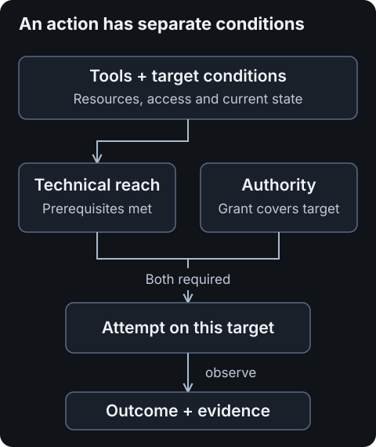
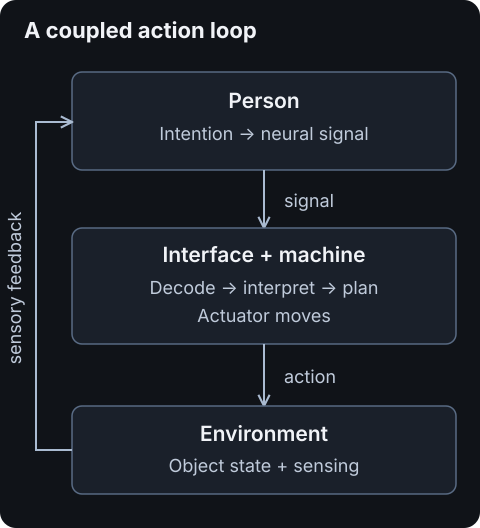

# The affordance frontier

> Theory, ahead of the software. [Why Ambit](./why-ambit.md) gives the argument; the [README](../README.md) describes what runs today.

## The object

The affordance frontier is the set of outcomes an assembled human-machine system can bring about. Its reach depends on people, tools, resources, authority and the environment in which they act.

Ambit currently models a narrow slice: a person's agents, tools and machines. The broader theory includes physical, cognitive, social, institutional and economic action.



## Why the theory says "affordance"

A hammer affords hammering to someone who can wield it, against a suitable target. The ability depends on that relationship.

Digital action works the same way. Shell access contributes to *modify this running service* only when the credentials, network, target software and authority line up. A robot's gripper contributes to *open this door* only when its geometry, force, reach and perception suit the door in its current state.

The product uses the plainer word *capability*. Providers and the capabilities they supply are separate nodes.

## The hard cases

### Robotics

Consider delivering medication to a patient:

| Contribution | Example |
| :--- | :--- |
| Planning | Route and task selection |
| Perception | Cameras and localization |
| Actuation | Mobile base and gripper |
| Authority | Permission to operate in this ward |
| Human participation | Pharmacist loads the medication |
| Environment | Elevator interface is reachable |
| Acceptance evidence | Recipient confirms delivery |

The delivery depends on the whole arrangement. Declaring a robot as infrastructure establishes none of its physical performance or safety.

Physical agency can also be distributed across machines and people. The relevant questions are which actions they can perform together, under what conditions, and through which actuators.

### Brain-computer interfaces

A brain-computer interface couples intention, decoding, planning, actuation and sensory feedback. Picking up a cup depends on that circuit.



Human participation takes different forms: approving an action, supplying knowledge or judgment, and using a machine to extend perception or movement. Approval is an authority dependency; knowledge is a contribution to performing the task. The map marks capabilities supplied jointly by a person and machine, but does not model a neural control loop.

## From reachable actions to demonstrated outcomes

A dependency chain describes a modeled route. Testing the assembled workflow requires a defined result, an attempt and acceptance evidence. Separate deployment and monitoring checks do not establish that a system can release a service and recover from a bad release.

Each attempt needs its actual target, environment, time and available resources. Reach, permission and observed success remain separate facts. Evidence from staging supports a claim about staging and grants no production authority. Repeated attempts establish an observed success rate for the conditions tested.

Ambit already records outcomes. [Roadmap §17](./roadmap.md#17-defined-outcomes--proposed) proposes binding versioned success criteria to the setup and evidence from each attempt. That layer is unbuilt.

## Applications worth testing

These are proposed applications, grouped by their relation to the current model. Their feasibility and demand need testing.

### Changes to an agent setup

- **Unexpected composition.** Explain which modeled actions a setup change opens. A claim about publishing private files needs a path connecting the file scope, destination and actual execution.
- **Capability CI.** Compare a proposed setup with its baseline against explicit invariants, such as authority and an applicable check for a production-write route. Trust-boundary analysis needs more than dependency closure.
- **Outcome planning.** Find missing prerequisites, evidence and human contributions for a bounded objective. Today's goal routing selects curated capabilities; new strategy synthesis is unbuilt.
- **Composite verification.** Rehearse a complete workflow and its recovery path on a known target, retaining acceptance results, costs and human participation.

### Shared work

- **Human participation.** Locate repeated waits on a person and investigate their contribution. An interruption count cannot establish that judgment is dispensable.
- **Environment improvement.** Propose and test a reusable change for a recurring, classified limitation. Designing novel capabilities goes beyond authored acquisition recipes.
- **Team composition.** Compare complementary capabilities, handoffs and shared failures, accounting for availability and resource contention.
- **Portable evidence.** Share demonstrated results with their limits and provenance. Signatures establish origin; acceptance evidence supports the claim, and reproduction needs a comparable environment.

### Other settings

- **Institutional action.** Map records, deadlines and permissions needed to submit an appeal. Submission and a favorable institutional decision are separate outcomes.
- **Accessibility.** Identify barriers in interfaces and environments using accommodations and preferences the person chooses, without inferring limitations from identity or diagnosis.
- **Collective agency.** Model combined contributions to a cooperative or association, including consent, commitments and withdrawal.
- **Physical action.** Bind a workflow to device state, surroundings and safety constraints, supported by task evidence.

### Experiments and accountability

- **A benchmark across environments.** Keep the model, tasks, acceptance criteria and resource limits fixed while varying selected affordances. Repeat trials and record added human work and actual consumption.
- **Recursive capability acquisition.** Examine changes that enable further acquisition. Their feedback requires temporal planning, costs and enforced limits; static closure supplies no growth rate.
- **Incident reconstruction.** Preserve dependencies, grants and evidence at execution time. Today's frontier history stores states and lifecycles but displays current edges; it cannot reconstruct the full past operating envelope.
- **Shared infrastructure dependence.** Find common failure points across environments. Systemic analysis needs consistent identities, coverage information and privacy controls beyond today's signed aggregate imports.

### Economic agency

A paid service offers a concrete test: can its operator maintain delivery with less personal attention while retaining control and returns?

Customer acceptance, receipts and expenses need records separate from the assigned value of time. Control includes the ability to contact customers, change terms, export records and replace providers. Possessing code establishes little about those rights.

The same questions apply to collective ownership and options within employment. An operator's gains do not establish benefits for workers or customers; their changed options need separate evidence.

## Intellectual genealogy

| Field | Contribution |
| :--- | :--- |
| Cybernetics | Control through feedback |
| Sociotechnical systems | Joint effects of people, technology and institutions |
| Security and attack graphs | Permissions and topology composing into reachable paths |
| Capability approach | Resources distinguished from effective opportunities |
| Agent evaluation | Empirical task outcomes |
| Systems engineering and CMDBs | Dependencies and failure propagation |

Ambit combines dependency analysis with evidence and authority for one kind of assembled system. The capability approach motivates the distinction between possessing resources and having an effective opportunity to act.

The theory's longitudinal question is which outcomes become possible or cease to be possible:

```
C(S_t) = { outcomes S can reliably and legitimately cause at time t }
gained = C(S_t+1) \ C(S_t)
lost   = C(S_t) \ C(S_t+1)
```

The ledger implements a narrow structural comparison. It records gains and losses separately; a net count would hide contractions.

## The AGI thesis

This is speculation. General agency might arise through composition: models, persistence, tools, infrastructure and people supporting consequential action across domains.

Model performance and system reach can change independently. Better reasoning may add little practical reach without authority or infrastructure. An unchanged model may participate in more workflows after those conditions change. Both claims can be tested through controlled comparisons across environments.

Cross-domain composition is the hypothesis to examine: can the system pursue varied goals without a separately authored workflow for each? Neither a larger capability count nor a successful scenario establishes that breadth.

## What the software does with this

- Nodes distinguish capabilities, actions, providers, resources, actors, runtimes and credentials; edges distinguish their relationships.
- The infrastructure manifest can declare physical devices and services, with `runs_on` edges. The `physical` domain classifies them without validating physical task performance.
- Actions have their own grants and evidence. Authority and recorded checks can refer to a target, although a target label alone does not establish what a check exercised.
- Structural reach (`state`) and verification health (`lifecycle`) are separate. A passing check supports only the behavior it exercises.

Enforcement applies to `apply`, execution routed through the control-plane proxy, and Claude Code calls using the installed gate hook. Other runtimes choose whether to consult it. [The roadmap](./roadmap.md#status-at-a-glance) records the remaining gaps.
