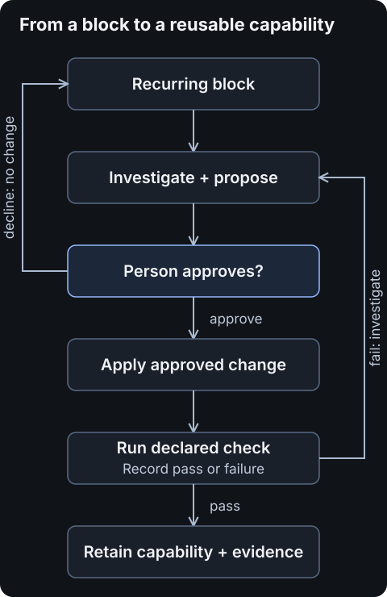

# Why Ambit

> This argument runs ahead of the software. The [README](../README.md) describes what runs today; [the roadmap](./roadmap.md) identifies what remains unbuilt.

I built Ambit because neither I nor the agents could keep my whole stack in our heads: models, MCP servers, skills, machines, hosted services, credentials and scheduled jobs.

Every component had configuration. Nothing described what the whole arrangement could do.

I wanted to know which addition would open useful work, which providers actually worked, and whether repeated failures shared one cause. Exposing the graph over MCP lets agents ask those questions too, without reconstructing the setup every session.

## Composition is the part that got interesting

Shell access, a network route, Docker, monitoring, a scheduler and scoped authority might support recovering a service while I am asleep. No individual config entry establishes that outcome.

Ambit keeps structural reach, check results and permission separate:

```
installed ≠ working ≠ authorized
```

A configured tool can fail. A working tool can lack permission. Even passing component checks leave the complete recovery workflow untested.

## What an agent could notice

After repeated blocks, an agent should help investigate the cause and propose a reusable change. A classified missing dependency can justify acquisition; an unexplained recurrence still needs investigation.



The useful result is a capability future sessions can reuse, with its dependencies, authority and evidence recorded. If a later check fails, the graph excludes it from current plans.

## Accounting, and then a ledger

Ambit accounts for capacity to act. It records what is configured, what checks have passed, who must participate and what may run without asking.

History makes changes inspectable: adding credentials or a scheduler can complete a modeled capability without adding a dedicated provider for it. Removing one shared dependency can contract several capabilities at once.

Today's snapshots preserve states, kinds and verification health. They use current names and edges when displayed. Reconstructing all routes and permissions at an incident's time requires additional historical records.

## Effective agency as a governed object

An unchanged model can participate in more consequential work when it gains tools, persistence, credentials or other participants. Those changes deserve review alongside model changes.

The design norm is:

> No increase in effective capability without a corresponding increase in legibility, verification, and governability.

An agent can propose expanding its environment. A person decides whether to approve the change; the executor checks authority, and evidence records what worked. Enforcement currently covers `apply`, routed control-plane execution and Claude Code with the gate hook installed. Other runtimes choose whether to consult it.

The next step is evidence about complete outcomes: what this setup delivered, on which target, within what limits and with how much human participation. [The affordance frontier](./affordance-frontier.md) develops that direction across digital, physical and institutional settings.
